# DevOps de WHEELS: pipeline, umbrales y reversión (Corte 3)

Este documento explica qué le pasa a un cambio desde que se hace el commit hasta que queda desplegado, qué verifica cada etapa del pipeline, qué umbral la detiene y por qué se eligió ese valor, y cómo se vuelve a una versión anterior. Las decisiones de fondo están en el [ADR-002 (despliegue)](adr/ADR-002-estrategia-de-despliegue.md) y el [ADR-003 (seguridad)](adr/ADR-003-seguridad-del-pipeline.md); dónde corre cada cosa, en la [vista de despliegue](diagramas/c4-despliegue.md).

## 1. Flujo de trabajo (GitHub Flow)

1. Cada cambio se hace en una rama (`corte3-...`, `fix-...`); nadie hace push directo a `main`.
2. El push a la rama ejecuta **CI** (`ci.yml`) en runners de GitHub.
3. Se abre un **Pull Request hacia `main`**. CI corre de nuevo y cada etapa aparece como un check.
4. `main` está protegida con un *ruleset*: para fusionar se necesitan **todos los checks en verde** y la **aprobación de otro integrante**.
5. Al fusionar, el push a `main` ejecuta **CD** (`cd.yml`): repite CI, publica la imagen y la despliega en el runner autohospedado.
6. Para publicar una versión se crea un tag semántico `vX.Y.Z` en `main` y se agrega su entrada en `CHANGELOG.md`; CD publica la imagen también con la etiqueta `X.Y.Z` y la despliega.

## 2. Diagrama del pipeline

```mermaid
flowchart LR
    subgraph ci["CI · ci.yml (push a ramas, PR a main, y como primera etapa de CD)"]
        direction TB
        build["Construcción<br/>npm ci + carga de módulos"]
        arq["Reglas de arquitectura<br/>dependency-cruiser"]
        uni["Pruebas unitarias<br/>+ cobertura del dominio ≥ 80 %"]
        int["Pruebas de integración<br/>SQLite, QR, API por HTTP"]
        movil["App móvil<br/>tsc + lint"]
        sast["SAST<br/>CodeQL"]
        sca["SCA<br/>Trivy fs"]
        sec["Secretos<br/>Gitleaks (historial)"]
        img["Imagen<br/>build + Trivy"]
        build --> arq & uni & int & img
    end
    subgraph cd["CD · cd.yml (push a main y tags vX.Y.Z)"]
        direction TB
        pub["Publicar en GHCR<br/>sha-&lt;commit&gt; (+ X.Y.Z)<br/>escaneo de la imagen"]
        dep["Desplegar<br/>compose up --wait<br/>(runner wheels)"]
        humo["Prueba de humo<br/>flujo principal"]
        slo["SLO con k6<br/>p95 ≤ 500 ms · errores < 1 %"]
        rev["Reversión automática<br/>(si algo falla)"]
        pub --> dep --> humo --> slo
        dep -. falla .-> rev
        humo -. falla .-> rev
        slo -. falla .-> rev
    end
    ci -->|todo en verde| pub
```



## 3. Etapas, umbrales y por qué

| Etapa (check) | Qué verifica | Detiene el pipeline cuando… | Por qué ese valor |
|---|---|---|---|
| **Construcción** | `npm ci` resuelve exactamente las dependencias del `package-lock.json`; `node --check` y la carga de todos los módulos (`npm run construir`) | Una dependencia no se resuelve o un módulo tiene error de sintaxis | Node no compila: cargar todo el grafo de módulos es el equivalente a "compila" |
| **Reglas de arquitectura** | 7 reglas del ADR-001 con dependency-cruiser (`backend/.dependency-cruiser.cjs`): dominio independiente, aplicación sin infraestructura, puertos sin implementaciones, la entrada HTTP no usa adaptadores de salida, solo `configuracion.js` conecta adaptadores, sin ciclos, sin dependencias de desarrollo en producción | Cualquier violación (una sola) | Una sola importación prohibida ya rompe la regla del estilo hexagonal; no tiene sentido tolerar "algunas" |
| **Pruebas unitarias y cobertura del dominio** | 126 pruebas del dominio y los casos de uso, con dobles de prueba; cobertura de líneas de `src/dominio` | Falla una prueba o la cobertura de líneas del dominio baja de **80 %** | El enunciado pide ≥ 70 %. Se endureció a 80 % porque el dominio ya está en ~98 %: el umbral deja margen para clases nuevas, pero impide que entre una regla de negocio sin pruebas |
| **Pruebas de integración** | 56 pruebas: SQLite real, QR real, notificadores y la API completa por HTTP (incluidos 401, 403 y la fuerza bruta del código) | Falla una prueba | Son las fronteras del hexágono con infraestructura real (embebida); cualquier falla es un defecto |
| **App móvil (tipos y lint)** | `tsc --noEmit` y `expo lint` | Error de tipos o de lint | El cliente no se despliega en el servidor, pero no debe llegar a `main` roto |
| **SAST (CodeQL)** | Código propio (backend y app), consultas `security-extended` | Un hallazgo con *security-severity* ≥ 7.0 sin tratar (`scripts/umbral-sast.sh`) | Mínimo del enunciado ("ningún alto o crítico sin tratar"), con un conjunto de consultas más amplio que el por defecto |
| **SCA (Trivy fs)** | Dependencias de `backend` y `mobile` | Una vulnerabilidad HIGH o CRITICAL con corrección disponible | Mínimo del enunciado; incluye la app aunque no se despliegue en el servidor |
| **Secretos (Gitleaks)** | Archivos e historial completo del commit probado | Un solo secreto | Un secreto expuesto ya está comprometido; el único umbral razonable es cero |
| **Imagen Docker y escaneo** | `docker compose config`, construcción de la imagen y Trivy sobre ella | Una vulnerabilidad CRITICAL con corrección disponible | Mínimo del enunciado; un umbral HIGH bloquearía por paquetes de Debian sin corrección publicada |
| **Publicar en GHCR** (CD) | Construye, escanea la imagen que se va a publicar y la sube con `sha-<commit>` (y `X.Y.Z` en tags) | Falla la construcción, el escaneo o el push | Se escanea exactamente lo que se publica |
| **Desplegar** (CD) | `scripts/deploy.sh`: `docker compose pull` + `up -d --wait` | El contenedor no llega a *healthy* en 120 s | El healthcheck (`/salud`) responde en milisegundos; 120 s cubre la descarga de la imagen |
| **Prueba de humo** (CD) | `scripts/smoke-test.sh`: salud y versión desplegada, 401 sin token, ingreso con código (leído de los logs), vehículo, programar, buscar, solicitar cupo, 403 al cancelar un viaje ajeno, aceptar, validar el QR y cancelar | Falla cualquiera de los pasos | Es el flujo principal de los Retos 1 y 3: si algo de eso no funciona, la versión no sirve |
| **SLO con k6** (CD) | `scripts/slo.sh` + `perf/slo.js`: 30 s a 20 búsquedas por segundo contra el entorno desplegado | **p95 > 500 ms** o **errores ≥ 1 %** (o checks < 99 %) | Es el SLO definido en el Corte 2 antes de medir (`pruebas.md`), escrito como `thresholds` de k6. 30 s × 20/s = 600 peticiones: suficientes para un p95 estable sin alargar el pipeline. La prueba larga se lanza a mano (`carga-larga.yml`) |

**Reportes como artefactos de cada ejecución:** `reportes-pruebas-unitarias` (JUnit y LCOV), `reportes-pruebas-integracion`, `reporte-arquitectura` (grafo HTML), `reporte-sast` (SARIF), `reporte-sca`, `reporte-secretos`, `reporte-imagen`, `reporte-imagen-publicada` y `reporte-slo`.

**Duración:** el CI completo tarda alrededor de **1 a 2 minutos** (los jobs corren en paralelo; el más lento es CodeQL, cerca de 1 minuto), por debajo del límite de 10 minutos. `actions/setup-node` guarda en caché las dependencias de npm del backend y de la app.

## 4. Protección de `main`

*Settings → Rules → Rulesets → `proteger-main`*, aplicado a la rama por defecto:

- *Require a pull request before merging* con **1 aprobación** requerida.
- *Require status checks to pass*: Construcción, Reglas de arquitectura, Pruebas unitarias y cobertura del dominio, Pruebas de integración, App móvil (tipos y lint), SAST (CodeQL), SCA (dependencias con Trivy), Secretos (Gitleaks) e Imagen Docker y escaneo (Trivy).
- *Block force pushes* y *Restrict deletions*.

## 5. Versionado semántico

`MAYOR.MENOR.PARCHE` en `backend/package.json`, en el tag de Git (`v3.0.0`) y en `CHANGELOG.md`. La versión 3.0.0 es mayor porque la API dejó de aceptar peticiones sin token (cambio incompatible con la app del Corte 2). La imagen de cada push a `main` responde en `/salud` con `3.0.0+sha.<commit>`; la de un tag, con `3.0.0`.

Para publicar una versión (desde `main` actualizada):

```bash
git tag -a v3.0.0 -m "WHEELS 3.0.0 - Corte 3"
```
```bash
git push origin v3.0.0
```

## 6. Reversión

**Automática:** si el despliegue, la prueba de humo o el SLO fallan, el paso *Reversión automática* del job `desplegar` ejecuta `scripts/rollback.sh`, que vuelve a desplegar la imagen anterior (guardada en `~/.wheels-despliegue/anterior` del servidor) y repite la prueba de humo. El pipeline queda en rojo igual: la versión nueva no pasó.

**Manual desde GitHub (recomendada):**

1. Ir a *Actions → CD → Run workflow*.
2. En *tag* escribir la etiqueta de la imagen a la que se quiere volver: `sha-<commit>` o una versión (`3.0.0`). Las etiquetas disponibles están en *Packages → wheels-backend*.
3. El job **Reversión manual** valida el tag, descarga esa imagen, la despliega y ejecuta la prueba de humo. Resultado esperado: el job en verde y `/salud` respondiendo con la versión de esa imagen.

**Manual en el servidor (si GitHub no está disponible):**

```bash
cd ~/actions-runner-wheels/_work/Wheels-alternative/Wheels-alternative
```
```bash
COMPOSE_PROJECT_NAME=wheels-produccion PUERTO_BACKEND=8091 SECRETO_TOKEN=<valor-del-secreto> scripts/rollback.sh ghcr.io/danielforero14/wheels-backend:<tag>
```

**Evidencia de que se probó:**

| Prueba | Dónde | Resultado |
|---|---|---|
| Despliegue de dos versiones y reversión con `scripts/rollback.sh` en local (proyecto de Compose separado) | Máquina del equipo, 16-11-2026 | La versión 2 se desplegó; la reversión volvió a la 1 y la prueba de humo pasó |
| Reversión manual desde GitHub Actions | *Se registra aquí el enlace a la ejecución cuando el pipeline de CD corra en `main`* | — |

## 7. Ejecutar las verificaciones a mano

Desde `backend/`:

```bash
npm run construir
```
```bash
npm run arquitectura
```
```bash
npm run test:unitarias
```
```bash
npm run test:integracion
```

Desde la raíz (requieren Docker):

```bash
scripts/sca.sh
```
```bash
scripts/secretos.sh
```
```bash
docker build -t wheels-backend:local backend && scripts/escaneo-imagen.sh wheels-backend:local
```

Despliegue completo en un proyecto aparte (con un `.env` creado a partir de `.env.example`):

```bash
COMPOSE_PROJECT_NAME=wheels-prueba PUERTO_BACKEND=8092 scripts/deploy.sh wheels-backend:local
```
```bash
COMPOSE_PROJECT_NAME=wheels-prueba PUERTO_BACKEND=8092 scripts/smoke-test.sh && COMPOSE_PROJECT_NAME=wheels-prueba scripts/slo.sh
```
