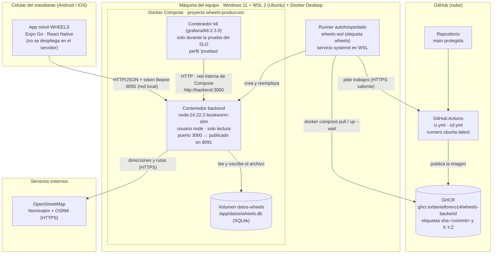

# Vista de despliegue (C4 – despliegue)

Muestra dónde corre cada contenedor de WHEELS y cómo se comunican. Corresponde a lo que despliega `.github/workflows/cd.yml` con `docker-compose.yml` (decisión en el [ADR-002](../adr/ADR-002-estrategia-de-despliegue.md)).

| Elemento | Dónde corre | Detalle |
|---|---|---|
| `backend` | Contenedor en la máquina del equipo | Imagen de GHCR con la etiqueta `sha-<commit>` del despliegue. Healthcheck `GET /salud`. Variables: `SECRETO_TOKEN` (de GitHub Secrets), `RUTA_BD=/app/datos/wheels.db`, `VERSION_APP` (dentro de la imagen). `read_only`, `cap_drop: ALL`, `no-new-privileges` |
| Volumen `datos-wheels` | Docker (dentro de Docker Desktop) | Archivo SQLite; sobrevive a los despliegues y a `docker compose down` (se borra solo con `down -v`) |
| `k6` | Contenedor temporal en la misma red | Solo existe durante `scripts/slo.sh` (después de cada despliegue y en `carga-larga.yml`) |
| Runner `wheels-wsl` | Servicio de systemd en WSL | Hace conexiones salientes a GitHub; ejecuta los jobs `desplegar`, `revertir` y `carga` |
| App móvil | Celular de cada estudiante | Se conecta a `http://<IP-de-la-máquina>:8091` en la red local. Detalle en `implementacion.md` |
| GHCR | GitHub | Registro de las imágenes; el runner descarga con el `GITHUB_TOKEN` del job (`packages: read`) |
| OpenStreetMap | Internet | Servicio de rutas real (Reto 3). Si falla, el backend usa el respaldo `RutasEstimadas` |

**Puertos de la máquina:** 8091 (WHEELS en producción), 3000 (WHEELS en desarrollo, si se levanta con `docker compose up` desde el `.env` de desarrollo).
