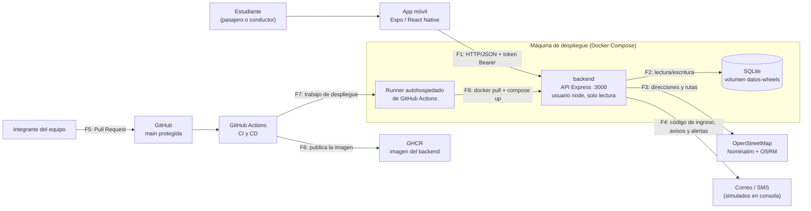

# Seguridad de WHEELS (Corte 3)

Este documento tiene cinco partes: los componentes y flujos analizados, el modelo de amenazas (STRIDE), el inventario de datos personales, los controles de seguridad del pipeline con sus umbrales y el registro de hallazgos. La decisión de qué herramientas y umbrales usar está en el [ADR-003](adr/ADR-003-seguridad-del-pipeline.md).

## 1. Componentes y flujos analizados

Parte del diagrama de contenedores del Corte 2 ([c4-contenedores.md](diagramas/c4-contenedores.md)) y le agrega lo que el Corte 3 puso en el camino de un cambio: el repositorio, el pipeline, el registro de imágenes y el runner que despliega.

## 2. Modelo de amenazas (STRIDE)

Cada amenaza nombra el componente o flujo de WHEELS donde ocurre. Las de autenticación y autorización se mitigan con el token de sesión y las reglas de autorización de los casos de uso, que se agregaron en este corte (antes el backend confiaba en el correo que enviaba la app; ver H-05).

| ID | Amenaza | STRIDE | Componente o flujo | Mitigación | Cómo se verifica |
|---|---|---|---|---|---|
| A1 | Un atacante prueba códigos de 6 dígitos en `/auth/verificar` hasta adivinar el de otro estudiante y entra con su cuenta | Suplantación | F1 → `ServicioUsuarios` / `CodigoVerificacion` | El código se genera con `crypto.randomInt`, vence a los 10 minutos, sirve una vez y **se bloquea al quinto intento fallido** (regla del dominio; los intentos se guardan en SQLite) | Unitarias de `CodigoVerificacion` y `ServicioUsuarios` (4 fallos aún permite, 5 bloquea, código nuevo reinicia); integración *"Suplantación por fuerza bruta"* (HTTP) |
| A2 | Un estudiante envía el correo de otro en `pasajeroId`, `conductorId` o `usuarioId` para reservar, aceptar solicitudes o activar alertas a su nombre | Suplantación | F1 → `crearApp.js` | Todas las rutas (salvo `/`, `/salud` y `/auth/*`) exigen `Authorization: Bearer <token>`. El usuario que actúa sale **solo del token**; los campos del cuerpo se ignoran | Integración *"Suplantación: el pasajero no puede reservar a nombre de otro"* y *"sin token... se responde 401"*; prueba de humo después de cada despliegue |
| A3 | Un estudiante modifica su token (cambia el correo o el rol a `conductor`) o lo reutiliza indefinidamente | Manipulación | F1 → `tokens.js` | Firma HMAC-SHA256 con `SECRETO_TOKEN` (≥ 32 caracteres, fuera del código), comparación en tiempo constante y vencimiento de 12 h | `tokens.test.js`: token alterado, de otra clave, vencido (valor límite) y mal formado → rechazado; integración: token alterado → 401 |
| A4 | Otro conductor cancela un viaje ajeno, valida el QR de un viaje que no es suyo, o un pasajero programa viajes | Elevación de privilegios | F1 → `ServicioViajes`, `ServicioReservas` | Reglas de autorización en los casos de uso (`ErrorDeAutorizacion` → 403): solo el conductor del viaje lo cancela, responde solicitudes y valida el QR; programar exige rol `conductor` | Unitarias de los servicios; integración *"Elevación de privilegios: otro conductor no puede cancelar el viaje ni validar su QR"* |
| A5 | Un usuario lee o cambia el contacto de emergencia, las reservas, el vehículo o las solicitudes de otro usando `/usuarios/<otro-correo>/...` | Divulgación de información | F1 → `crearApp.js` | Esas rutas solo las puede usar el dueño del correo (403). La placa del conductor solo la ve el pasajero aceptado | Integración *"Divulgación: nadie puede leer ni cambiar los datos de otro usuario (403)"* y *"la placa solo cuando lo aceptan"* |
| A6 | Un QR de abordaje se adivina, se reutiliza o se usa en otro viaje para subir al carro | Suplantación | Conductor → `POST /viajes/:id/abordar` → `Reserva` | Código aleatorio con `crypto`, de un solo uso, ligado al viaje y que vence al final del día del viaje (Corte 2) | Unitarias de `Reserva` y `ServicioReservas` (inventado, otro viaje, vencido, ya usado) e integración del flujo completo |
| A7 | Una petición mal formada hace que la API muestre la traza del error, rutas internas o la tecnología del servidor | Divulgación de información | F1 → `crearApp.js` | Manejador de errores genérico (`Petición inválida` / `Error interno`), sin cabecera `X-Powered-By`, `X-Content-Type-Options: nosniff`, cuerpo JSON limitado a 20 kB | Integración *"JSON mal formado responde 400 sin detalles"* y *"no anuncia la tecnología del servidor"* |
| A8 | Muchas alertas o búsquedas a la vez (por ejemplo, un accidente en la vía) saturan la única instancia de la API y el botón de pánico deja de responder | Denegación de servicio | F1 → API (una sola instancia) | SLO p95 ≤ 500 ms y errores < 1 % verificado con k6 después de cada despliegue; caché de rutas; healthcheck y `restart: unless-stopped` | Prueba de carga del SLO en el job de despliegue (CD); prueba de pico manual `perf/scripts/emergencia-pico.js` |
| A9 | Una dependencia de npm o un paquete de la imagen base trae una vulnerabilidad conocida que permite atacar la API | Manipulación / Elevación | F5 → F6 (cadena de suministro) | SCA con Trivy y escaneo de la imagen con Trivy como quality gates; imagen base con versión fija; Dependabot | Jobs *SCA* e *Imagen Docker y escaneo* en cada PR; PR bloqueado de demostración (sección 6) |
| A10 | La clave `SECRETO_TOKEN` o una credencial de despliegue queda en el código o en el historial de Git y cualquiera puede firmar tokens válidos | Divulgación de información | F5 → repositorio | `.env` en `.gitignore`; valores reales solo en GitHub Secrets/Environments; Gitleaks sobre todo el historial | Job *Secretos (Gitleaks)* en cada PR; PR bloqueado de demostración (sección 6) |
| A11 | Una vulnerabilidad en la API permite ejecutar código dentro del contenedor y desde ahí tocar el servidor | Elevación de privilegios | F8 → contenedor `backend` | Usuario `node` (sin root), sistema de archivos de solo lectura salvo el volumen de datos, `cap_drop: ALL`, `no-new-privileges` | `docker compose exec backend whoami` → `node`; escribir fuera de `/app/datos` → *Read-only file system* (verificado a mano y en la prueba de humo) |
| A12 | Un Pull Request malicioso ejecuta código en el runner autohospedado (la máquina de despliegue) | Elevación de privilegios | F7 → runner | Los PR corren en runners de GitHub; solo los jobs de `main` (tras el merge aprobado) y la reversión manual usan el runner; `main` protegida con revisión obligatoria | Configuración de `cd.yml` (job de despliegue con `if` sobre `main`) y ruleset de `main` |
| A13 | Un conductor niega haber aceptado a un pasajero, o un pasajero niega haber abordado | Repudio | `ServicioReservas` → SQLite | El estado de cada reserva (pendiente, aceptada, rechazada, usada) queda guardado y cada acción exige el token de quien la hace | Integración del flujo solicitar → aceptar → abordar. **Riesgo aceptado (H-08):** no hay bitácora de auditoría con fecha y autor de cada acción |

## 3. Inventario de datos personales

| Dato | Dónde se guarda | Quién lo puede ver |
|---|---|---|
| Correo institucional y nombre | Tabla `usuarios` | El propio usuario; el nombre lo ven los pasajeros (conductor) y el conductor (pasajeros que le piden cupo) |
| Placa y descripción del vehículo | Tabla `vehiculos` | El conductor y los pasajeros que él aceptó |
| Punto de recogida | Tabla `reservas` | El pasajero y el conductor del viaje |
| Nombre y teléfono del contacto de emergencia | Tabla `contactos` | Solo el usuario dueño |
| Ubicación (latitud y longitud) | No se guarda: viaja en la alerta de pánico y en la consulta de tiempo estimado | El contacto de emergencia (en el mensaje) y OpenStreetMap (coordenadas sin identificar al usuario) |

## 4. Controles del pipeline

Los cuatro controles corren en cada push y en cada Pull Request (`.github/workflows/ci.yml`) y lo detienen si superan el umbral. Los umbrales son **iguales o más estrictos** que los del enunciado; la justificación está en el [ADR-003](adr/ADR-003-seguridad-del-pipeline.md).

| Control | Herramienta | Qué revisa | Umbral que detiene el pipeline | Script |
|---|---|---|---|---|
| Análisis estático (SAST) | CodeQL `javascript-typescript` con `security-extended` | Código del backend y de la app | Ningún hallazgo con *security-severity* ≥ 7.0 (alto o crítico) sin tratar. CodeQL solo reporta: el script lee el SARIF y falla | `scripts/umbral-sast.sh` |
| Análisis de dependencias (SCA) | Trivy 0.76.0 (`fs`) | `backend/package-lock.json` y `mobile/package-lock.json` | Ninguna vulnerabilidad HIGH o CRITICAL con corrección disponible | `scripts/sca.sh` |
| Detección de secretos | Gitleaks 8.30.1 | Archivos y **todo el historial** del código que se integra (todos los commits alcanzables desde el commit probado; en un PR incluye el historial de `main`) | Cero secretos | `scripts/secretos.sh` |
| Escaneo de la imagen | Trivy 0.76.0 (`image`) | Sistema operativo y librerías dentro de `wheels-backend` | Ninguna vulnerabilidad CRITICAL con corrección disponible | `scripts/escaneo-imagen.sh` |

**Cómo se trata un hallazgo que no se corrige:** se registra en la sección 5 como *falso positivo* o *riesgo aceptado* y solo entonces se agrega su identificador a `.trivyignore` (SCA e imagen) o a `.github/codeql/excepciones-sast.txt` (SAST), con el número del hallazgo como comentario. Una excepción sin registro aquí cuenta como un control desactivado.

Dependabot (`.github/dependabot.yml`) abre PR semanales de actualización; no reemplaza el control de SCA.

## 5. Registro de hallazgos

| ID | Hallazgo | Origen | Severidad | Decisión | Detalle |
|---|---|---|---|---|---|
| H-01 | `proxy-addr` (suplantación de IP), `body-parser` (DoS) y `qs` (DoS) en el backend, dependencias de Express | `npm audit` / SCA | Crítica, alta y moderada | **Corregido** | `npm audit fix`, commit [abb2e34](https://github.com/DanielForero14/Wheels-alternative/commit/abb2e341ddd8b16d36d726a2cf5e37b963b921f8). Desde entonces el backend tiene 0 vulnerabilidades |
| H-02 | `decode-uri-component` 0.2.2 (CVE-2026-45822, CVE-2026-118664): DoS al decodificar un texto con `%` manipulado. Llega por `query-string` 7 → `expo-router` 6 en la app móvil | SCA (Trivy / `npm audit`) | Alta | **Riesgo aceptado** | La corrección (0.5.x) solo se publica como módulo ESM y rompe `query-string` 7, que usa `require`; forzarla con `overrides` rompe Expo. El impacto es una DoS **en el propio celular** del usuario al abrir un enlace manipulado: no afecta al servidor ni a otros usuarios. **Para corregirlo:** migrar a Expo SDK 55+ (expo-router con `query-string` actualizado) y repetir la prueba de la app. Excepción en `.trivyignore` |
| H-03 | `image-size` 1.2.1 (CVE-2025-71329, CVE-2025-71330): DoS con imágenes JXL, HEIF o ICNS manipuladas | SCA (Trivy / `npm audit`) | Alta | **Riesgo aceptado** | Solo lo usa Metro al empaquetar la app en el equipo del desarrollador, con las imágenes del propio repositorio; no corre en el celular ni en el servidor. La corrección es la versión mayor 2.x, que Metro no admite. **Para corregirlo:** actualizar Expo/Metro a la versión que use `image-size` ≥ 2.0.3. Excepción en `.trivyignore` |
| H-04 | App móvil: 1 crítica (`shell-quote`) y 12 altas en dependencias transitivas | `npm audit` / SCA | Crítica y altas | **Corregido** | `npm audit fix` y `overrides` de `brace-expansion@1` → 1.1.22 y `postcss` → 8.5.33 (misma versión mayor). Se verificó que la app compila (`tsc`), pasa el lint y Metro la empaqueta (`expo export`). Commit [da284ac](https://github.com/DanielForero14/Wheels-alternative/commit/da284ac) |
| H-05 | El backend confiaba en `conductorId`/`pasajeroId`/`usuarioId` del cuerpo: cualquiera podía actuar a nombre de otro (A2) | Revisión del modelo de amenazas | Alta | **Corregido** | Token de sesión firmado y usuario tomado del token. Commit [3e90df5](https://github.com/DanielForero14/Wheels-alternative/commit/3e90df597f79f09d5fd17a8b2e97d7f9829a2cc8) |
| H-06 | `POST /viajes/:id/cancelar` y `POST /viajes/:id/abordar` no revisaban quién hacía la acción (A4) | Revisión del modelo de amenazas | Alta | **Corregido** | Reglas de autorización en `ServicioViajes` y `ServicioReservas` (403). Commit [3e90df5](https://github.com/DanielForero14/Wheels-alternative/commit/3e90df597f79f09d5fd17a8b2e97d7f9829a2cc8) |
| H-07 | Intentos ilimitados para el código de ingreso de 6 dígitos: fuerza bruta (A1) | Revisión del modelo de amenazas | Alta | **Corregido** | Bloqueo al quinto intento fallido, guardado en SQLite. Commit [da284ac](https://github.com/DanielForero14/Wheels-alternative/commit/da284ac) |
| H-08 | No hay bitácora de auditoría (quién aceptó, canceló o validó, y cuándo) (A13) | Revisión del modelo de amenazas | Baja | **Riesgo aceptado** | El estado final de cada reserva queda guardado y cada acción exige el token de su autor, pero no se registra la historia. **Para corregirlo:** un puerto `IBitacora` con un adaptador que guarde (usuario, acción, recurso, fecha) en una tabla de solo inserción |
| H-09 | No hay límite de peticiones por cliente (*rate limiting*) en la API (A8) | Revisión del modelo de amenazas | Media | **Riesgo aceptado** | La amenaza más grave que mitiga (fuerza bruta del código, A1) ya está cubierta por el bloqueo de intentos, y el SLO se verifica en cada despliegue. **Para corregirlo:** un *proxy* inverso (por ejemplo Nginx o el balanceador del proveedor) con límite por IP delante de la API |

## 6. Evidencia de que los controles funcionan

*(Se completa con los enlaces a los Pull Requests que introducen un problema a propósito, que el pipeline bloquea y que se cierran sin fusionar.)*
